# Bezaleel Paul N
### Computer Science Student · AI/ML · Software Engineering

**Building useful software at the intersection of AI, applications, and real-world engineering.**

[GitHub](https://github.com/BezaleelPaul) · [LinkedIn](https://in.linkedin.com/in/bezaleel-pauln) · [Portfolio repository](https://github.com/BezaleelPaul/Testingwebsite-) · [Email](mailto:bezaleel321@gmail.com)

---

## `$ whoami`

- **Based in:** Bengaluru, India
- **Education:** B.Tech in Computer Science & Engineering, CMR University
- **Also pursuing:** BS in Data Science and Applications, IIT Madras
- **Current focus:** Python, Java, DSA, AI/ML, Flutter, and full-stack engineering
- **Approach:** Learn by building, testing, presenting, and iterating.

---

## `$ cat ./selected-work`

A selection of public projects. Work that is still private or not ready for public release is intentionally omitted.

| Project | What it is |
|---|---|
| [Drishti](https://github.com/BezaleelPaul/Drishti) | Offline-first diabetic-retinopathy screening and triage platform with edge inference and clinical workflow tooling. |
| [MedMultiSync](https://github.com/BezaleelPaul/multimodal-ai-healthcare) | Academic multimodal healthcare AI project combining medical imaging, clinical text, and EHR signals. |
| [AI Visual Smart Rover](https://github.com/BezaleelPaul/ai-autonomous-exploration-rover) | Robotics proof-of-concept combining ESP32-CAM vision, Arduino control, sensing, and a mobile companion app. |
| [Orbital Observatory](https://github.com/BezaleelPaul/Orbital-Observatory) | Space-themed software project currently under development. |
| [File Organizer](https://github.com/BezaleelPaul/File-Organizer) | Python desktop utility for organizing files through a configurable GUI. |
| [BESCOM Calculator](https://github.com/BezaleelPaul/BESCOM-Calculator) | Electricity-bill calculator for domestic BESCOM tariff slabs. |

---

## `$ cat ./hackathons-and-engineering`

### Hackathons and competitive events

- **Smart India Hackathon 2026 — Internal Hackathon:** Team Lead of **Binary Architects (CMRU007)**; shortlisted from CMR University's internal hackathon for the next SIH stage.
- **COLOSSUS 3.0 — National-Level 24-Hour Hackathon:** Represented Team Tech Titans in HealthTech; placed **8th overall with 95/110 points**.
- **DECODE SIH 2026:** Participated in the OSCode-organized event; gained experience in integration, compatibility, usability, and real-world software constraints.
- **Meta PyTorch OpenEnv Hackathon × Scaler School of Technology:** Participated in the hackathon focused on AI/ML and practical problem-solving.

### Showcases and community

- **BLUEPRINT 2026 — CMR University:** Contributed to **MedMultiSync**, a multimodal healthcare AI project showcased by teammates at the Software Design Showcase; received a Certificate of Participation.
- **Flutter South India 2026 — SRM IST, Chennai:** Attended community sessions and developer discussions; secured **2nd place in the Flutter Kanpur Kahoot challenge**.
- **Arduino & Raspberry Pi Project Expo 2026:** Presented the AI-assisted autonomous exploration rover developed with Team Binary Architects.
- **IEEE CMR University Student Branch:** Former ExeCom member and Webmaster; contributed to student-branch web presence and technical activities.

---

## `$ cat ./experience-and-learning`

- **Eazy Walkers Digital:** Software Development Intern.
- **NPTEL — Data Structures and Algorithms Using Java:** Elite certification, **67%** consolidated score (July–October 2026).
- **IIT Madras:** BS Data Science and Applications programme, alongside B.Tech CSE at CMR University.

---

## `$ ls ./toolkit`

**Languages:** Python · Java · Dart · JavaScript · TypeScript · C · C++

**Development:** Flutter · Git · GitHub · REST APIs · Full-stack development

**AI and engineering:** Machine Learning · Computer Vision · Explainable AI · IoT · Embedded Systems

*Technologies listed reflect areas used in projects and coursework; proficiency varies by tool.*

---

## `$ ./competitive-programming`

LeetCode snapshot shared on **26 November 2026**: **137 problems solved**, **186 submissions**. The live profile is the source of truth for future changes.

Other coding-platform links will be added after their current handles are confirmed.

---

## `$ git status --short ./github`

<picture>
  <source media="(prefers-color-scheme: dark)" srcset="https://github.com/BezaleelPaul/BezaleelPaul/raw/output/github-contribution-grid-snake-dark.svg" />
  <source media="(prefers-color-scheme: light)" srcset="https://github.com/BezaleelPaul/BezaleelPaul/raw/output/github-contribution-grid-snake.svg" />
  
</picture>

---

## `$ ping ./connect`

*Build. Learn. Iterate.*

